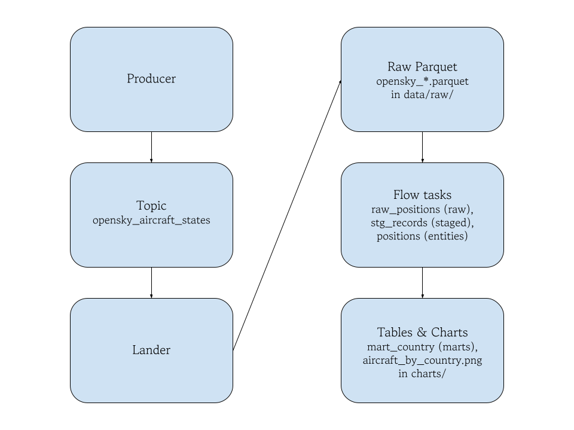
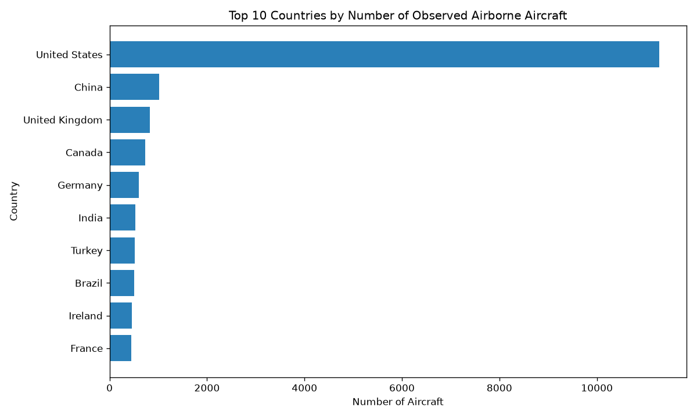

# OpenSky Streaming Pipeline

**Author:** Liana Kim
**DS 3022 Data Project 3, Fall 2026**

## Data source

The data source of this project is OpenSky Network via the URL https://opensky-network.org/api/states/all. Live REST API polling method is used to pull the data rather than replayed from an archived dataset. Each message contains icao24, callsign, origin_country, time_position, last_contact, longitude, latitude, baro_altitude, on_ground, velocity, true_track, vertical_rate, sensors, geo_altitude, squawk, spi, position_source, and snapshot_time. There are no account, key, or User-Agent required for this data.

## How to run

```bash
cd ds3022-streaming # enter cloned repository
python3 -m venv .venv # create virtual environment - use if macOS/Linux
python -m venv .venv # create virtual environment - use if Windows (Powershell)
source .venv/bin/activate # activate virtual environment - use if macOS/Linux
.venv\Scripts\Activate.ps1 # activate virtual environment - use if Windows (Powershell)
pip install -r requirements.txt # install required packages
cd project3 # switch into project3 folder
docker compose up -d # start the Redpanda cluster
docker exec -it redpanda-0 rpk topic create opensky_aircraft_states -p 3 -r 3 
 # create the topic with 3 partitions and replication factor 3
docker exec -it redpanda-0 rpk cluster info # check cluster status and broker information
python producer.py # run in Terminal 1 to fetch data
python lander.py # run in Terminal 2 to store data
python flow.py data/sample # run the flow on the committed sample dataset without Kafka
```

## Architecture



## Design decisions

Answer each in 2-4 sentences, in your own words, with your own numbers.

1. **Key and partitions.** The Kafka key is icao24, which is the unique ICAO transponder identifier assigned to an aircraft. It was chosen because it allows the flow to group all observations belonging to the same aircraft together. Kafka uses the key to determine which partition a message is assigned to, meaning records with the same icao24 key are sent to the same partition. This guarantees that observations for the same aircraft maintain their order within that partition. If another key were used, observations from the same aircraft could be distributed across different partitions. This would make it harder to track an aircraft's movements over time and could result in records being processed out of order relative to one another.

2. **Batch size and time.** The batch size is 1000 and the time limit is 60 seconds. A batch is written when it has 1000 records or is 60 seconds old, whichever happens first. Since probe.py showed that 9,610 records land per request made every 60 seconds, the batch size rule closes most batches. This results in approximately 577 files per hour (9,610 records per minute divided by 1,000 records per batch, multiplied by 60 minutes).

3. **Offsets after the file.** If the lander crashes after writing a file but before storing offsets, this means that the same raw data will be landed again when lander.py restarts, which demonstrates the at-least-once delivery concept. Although the number of raw records will increase, this is handled further down the pipeline in flow.py's stage() function, where deduplication is performed and only unique Kafka records are kept in the stg_records table. This trade-off is accepted because it is better to potentially process duplicate records than to lose data. Duplicates can be removed during the staging process, whereas lost records cannot be easily recovered.

4. **Duplicates.** Two records are considered the same Kafka record if they have the same topic, partition and offset. The partition identifies which section of the topic contains the record, while the offset identifies its position within that partition. Having the same icao24 and time_position would signal two records being the same real-world observation for OpenSky data. The first type of duplication is removed in the stage() function in flow.py using SELECT DISTINCT * EXCLUDE (landed_at), which removes duplicate landed records while ignoring the landing timestamp. The second type is removed in the entities() function in flow.py using ROW_NUMBER() with PARTITION BY icao24, time_position and QUALIFY ... = 1. This keeps only one record for each aircraft and observation time, choosing the most recent snapshot using ORDER BY snapshot_time DESC.

5. **Windows and time.** This pipeline uses event time, derived from time_position, to identify when an aircraft observation actually occurred. The entities() function uses icao24 and time_position to deduplicate observations, ensuring that only one record is kept per aircraft and time. Since the research question in this project focuses on comparing the number of observed airborne aircraft across different countries, rather than analyzing changes over time, window sizes are not relevant in this project. However, if the question were time-based, then event time would be used since it indicates when the events actually happened in real life, rather than when they were received and landed in the system.

6. **Ten times the volume.** The part of the pipeline that break or slow down first at ten times the volume would be the lander since it would have to consume and process a much larger number of records. If the lander cannot consume records as quickly as the producer publishes them, this would result in a backlog in Redpanda. Methods to mitigate this issue would include increasing the batch size and increasing Redpanda resources.

## Chaos round

| Card | Prediction | What I did | Numbers before → after | Explanation |
|---|---|---|---|---|
| D1 Crash between file and offsets | The number of raw records will increase. | Ran python lander.py crash then ran python lander.py | raw 205,328 ; malformed 0 ; unique Kafka records 205,328 ; unique icao24+time_position 183,936 -> raw 212,088 ; malformed 0 ; unique Kafka records 211,088 ; unique icao24+time_position 189,652 | The number of records increased because the offset was not stored, so the records that landed before the crash were reprocessed after lander.py was run again. Additionally, there is an increase of unique Kafka records and unique icao24+time_position, but they increased less than the raw records, indicating that the reprocess did result in duplicates. They will be handled later in the flow. |
| D2 Poison message | The run will raise an exception and the number of malformed records will increase. | Sent a bad message after running docker exec -it redpanda-0 rpk topic produce opensky_aircraft_states -k bad | raw 212,088 ; malformed 0 ; unique Kafka records 211,088 ; unique icao24+time_position 189,652 -> raw 212,089 ; malformed 1 ; unique Kafka records 211,088 ; unique icao24+time_position 189,652 | The poison message was landed but is flagged as being malformed. Because it is not a valid message, the number of unique Kafka records and unique icao24+time_position does not change. If lander.py crashed, this would mean that subsequent records are not able to land, so flagging this record allows landing to continue smoothly without stopping. |
| D5 Send again | The number of raw and unique Kafka records will increase but the number of unique entities will not. | Sent records that were already landed by running two polls 5 seconds apart | raw 307,563 ; malformed 1 ; unique Kafka records 306,562 ; unique icao24+time_position 248,657 -> raw 323,563 ; malformed 1 ; unique Kafka records 322,562 ; unique icao24+time_position 257,080 | When identical records are published again, the raw and unique Kafka records increase since Kafka assigns new offsets to each publication. However, the unique entities should not increase because they represent the same real-world observations. What actually happened: Initially, I polled OpenSky twice, five seconds apart. However, the resulting snapshots were not identical, so the four-number summary showed an increase in unique entities, which was not supposed to happen. I then modified producer.py to publish the exact same snapshot twice instead of fetching two separate snapshots. This successfully demonstrated duplicate publication, as the snapshot-specific results showed 16,998 raw records, 16,998 unique Kafka records, and 8,499 unique entity records. Therefore, this experiment worked, although the four_numbers.py summary does not explicitly show the anticipated results. |

## The four numbers

From the flow log on the full data (screenshot in `docs/`):

| Number | Full data | Sample (`data/sample`) |
|---|---:|---:|
| Raw records landed | 324561 | 5000 |
| Malformed (kept in raw) | 1 | 0 |
| Unique Kafka records | 321659 | 4975 |
| Unique TODO (your entity) | 257080 | 4952 |

## Challenges / Obstacles

The OpenSky dataset was different from other datasets provided as examples in class, as it involved REST polling instead of WebSocket streaming. Instead of collecting individual events as they occurred, the producer retrieved snapshots containing multiple aircraft observations. This required adapting the producer to extract individual aircraft records from each response and publish them to Kafka.

## Analysis

My research question is a comparison question: Which countries have the highest number of observed airborne aircraft in the collected dataset? My chart is located in charts/aircraft_by_country.png and is titled Top 10 Countries by Number of Observed Airborne Aircraft. From this chart, the reader can see the top 10 countries with the highest number of observed airborne aircraft, with the United States having the highest number out of all countries, with China coming second and UK coming third.  One finding that surprised me is that the US ranks first by a significant amount. One limitation of my method is that it was specifically filtered for airborne aircrafts, not aircrafts on the ground. If a reader wanted to see results for all aircrafts, then this chart cannot answer that question.

## Plot / Visualization



## Reflection

From completing this project, I learned about stream processing and how high volumes of live data require a streaming platform to collect, store, and process data efficiently. In this case, I used Apache Kafka to request live data from an external source. I learned that brokers are essentially servers responsible for storing topic partitions and their assigned replicas. They receive records from producers and deliver records to consumers. I also learned how the raw records should be deduplicated and transformed into mart models to provide meaningful insights that answer the research question. This data can also be visualized through charts to make the results easier to understand. If I were to start this project again, I would spend more time fully understanding the overall pipeline and illustrating the architecture before coding. This would help me identify the inputs and outputs of each step of the pipeline as well as how each component interacts.

## Acknowledgements

Professor Pons helped answer any questions I had during our DS 3022 class. He also provided guide documents to walk students through each step in the project. The files probe.py, four_numbers.py, make_sample.py, and check_project.py were provided as part of the class materials. The files producer.py, lander.py, and flow.py were written using the provided templates quakes_producer.py, quakes_lander.py, and quakes_flow.py, respectively. I used AI assistance to troubleshoot runtime errors as well as cross-checking the logic from the marts() and chart() functions in flow.py. I reviewed the suggested solutions and checked that the code worked as expected.
